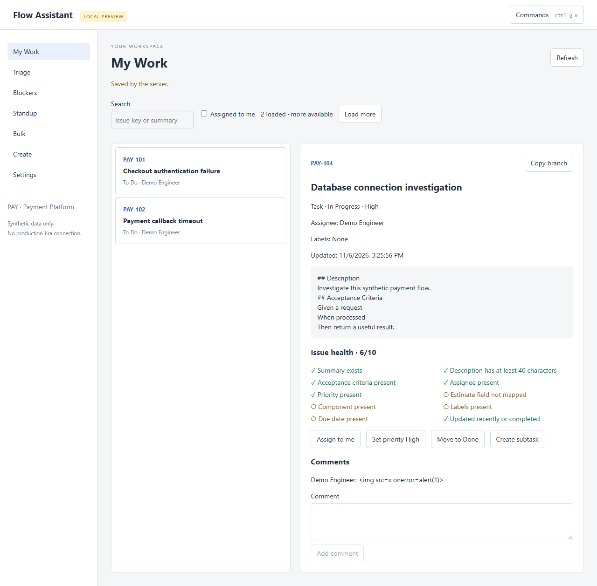
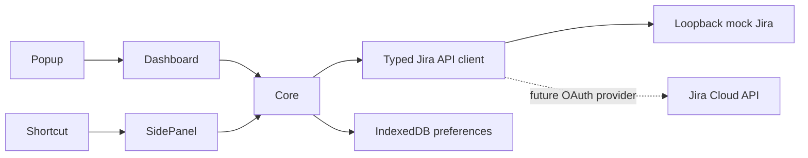

# Jira Flow Assistant

A productivity layer for Jira that helps you triage issues, find blockers, build standups, run safe bulk actions and navigate work faster.

**Status: v0.1 local preview, not a production Jira connector.** The working extension uses a local synthetic Jira server. A typed Cloud API adapter exists, but OAuth onboarding and real-site verification are not implemented. See [project status](docs/project-status.md) before using or evaluating this project.

## Why

Checking a few fields, assigning an issue and adding a comment should not require several page changes. This project puts those actions beside the issue and makes missing information visible.

## Features

- Issue search with cursor pagination and an assigned-to-me filter.
- Contextual issue details, server-discovered transitions, assignment and comments.
- Ten deterministic health checks, including missing acceptance criteria and stale work.
- Sequential triage, three creation templates and parent/subtask creation.
- Directed blocker edges and a comment-based, editable standup draft.
- Bulk label preview, explicit confirmation and per-issue results.
- IndexedDB preferences, strict settings import, field discovery and light/dark themes.
- An actual Chrome MV3 package, not just a web mockup.



## Command Palette

Use the Commands button or Ctrl/Cmd+Shift+K inside the dashboard. This preview palette navigates between screens. The browser shortcut opens the contextual side panel; Ctrl/Cmd+Shift+J opens creation. A full action palette is planned.

## Issue Health

Each check reports its own result; there is no AI score. A missing field mapping is shown as not mapped, not silently treated as an estimate. [Rules](docs/issue-health.md).

## Quick Create

Create PAY tasks or subtasks with Bug, Story or Support templates. Title similarity is token overlap against loaded issues, not proof of duplication. Real-site type IDs and required-field discovery are not yet wired into creation.

## Triage

Choose a task with a failed health check, assign it, set its mock High priority, change status or comment. Next issue advances through loaded work. Queue-specific filters and review counters remain planned.

## Blocker Graph

The Blockers screen shows directed dependency edges and counts over **loaded issues only**. It does not pretend to have fetched an entire release or determine resolution from a link alone.

## Standup Builder

Recent comments authored by the mock current user are included with timestamps. Today is an editable selection of assigned work, not invented activity. Transition-based standups are planned.

## Bulk Actions

Only add-label is implemented. Select issues, inspect Preview, then Apply. Failures are listed individually. Writes are not automatically retried; no universal Undo is offered. [Safety model](docs/bulk-actions.md).

## JQL Builder

The shared core constructs escaped project, summary/key and current-user queries. Search uses it. A visual advanced builder and Saved Views are planned. [Supported subset](docs/jql-builder.md).

## Privacy and security

No analytics, external AI, Jira passwords or credential forms. The preview talks only to the loopback mock server. React renders issue text, never raw Jira HTML. CSP disallows remote scripts; responses have a 1 MiB streaming limit. [Privacy](docs/privacy.md), [security](docs/security.md), [authentication](docs/authentication.md).

## Architecture



Code is split into `apps/extension`, `apps/mock-jira`, and shared packages for domain logic, API transport, storage and fixtures. [Architecture](docs/architecture.md).

## Installation and development

Node.js 24.14.1 or later; npm. No Docker or Jira account is needed.

```sh
npm ci
npm run build
npm run mock
```

Open `chrome://extensions`, enable Developer mode, select **Load unpacked**, and choose `dist`. Open the popup → dashboard → **Connect mock Jira**. Keep the mock terminal running.

For web development, run `npm run dev` in a second terminal and visit `http://127.0.0.1:5173`. Both servers bind to loopback. Restarting the mock resets all synthetic changes.

Windows disk-D setup and Linux/WSL instructions: [getting started](docs/getting-started.md).

## Testing

Stop manually running mock/dev servers first; the E2E runner owns ports 4318 and 5173.

```sh
npx playwright install chromium
npm run verify
npm audit
```

Verify runs formatting, ESLint, strict type checking, unit/integration tests, production compilation and Playwright (including the packaged extension). [Testing details](docs/testing.md).

## Screenshots

Captured by Playwright from real synthetic-data workflows: [My Work](docs/screenshots/my-work.png), [sidebar/health](docs/screenshots/issue-sidebar.png), [Triage](docs/screenshots/triage.png), [Blockers](docs/screenshots/blockers.png), [Standup](docs/screenshots/standup.png), [bulk preview](docs/screenshots/bulk-preview.png), [palette](docs/screenshots/command-palette.png), [installed extension](docs/screenshots/extension.png).

The literal HTML-looking comment in the sidebar screenshot is an XSS regression fixture; it is rendered as text.

## Roadmap and limitations

OAuth 3LO with secure secret handling, real-site validation, metadata-driven creation, full action palette, saved views, timeline, cache/offline mode, configurable shortcuts, complete accessibility audit and Firefox support are **not finished**. No store upload or stable v1.0 release is claimed.

See [the status matrix](docs/project-status.md) and [five-minute demo](DEMO.md).

## License and independence

MIT: a small permissive license makes the reusable client and rules easy to adopt. Jira and Atlassian are trademarks of their respective owners. This is an independent project, not an official or endorsed Atlassian product. A possible store display name is **Flow Assistant for Jira**.
